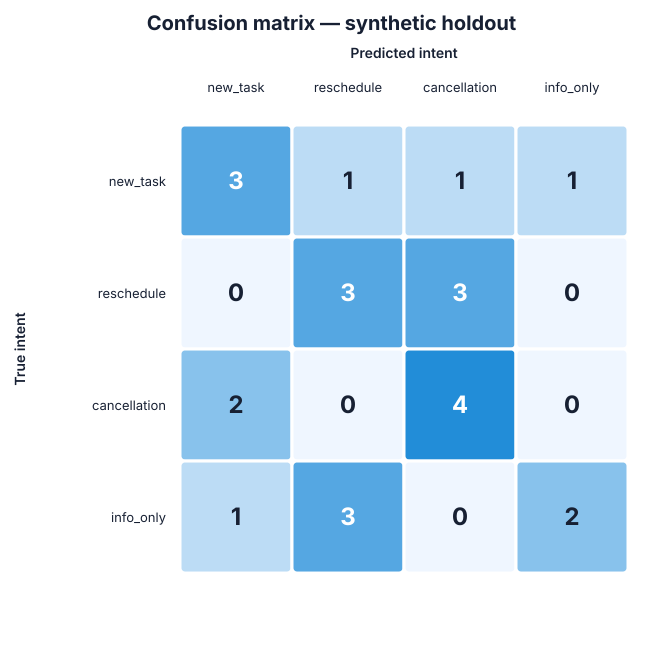

# FI'L AI Baseline Error Analysis

## Scope and validity warning

This analysis covers the existing TF-IDF + Logistic Regression baseline only. It does **not** train or modify a model. The full dataset contains 96 manually written **synthetic** Arabic messages, and the evaluated holdout contains only 24 synthetic messages. These results are useful for debugging the pipeline, but **cannot establish real-world accuracy, robustness, or deployment readiness**.

## Executive summary

- Accuracy: **0.500 (12/24, or 50.0%)**
- Macro precision: **0.524**
- Macro recall: **0.500**
- Macro F1: **0.494**
- Misclassifications: **12/24**
- Weakest recall: **info_only (0.333; 2/6 found)**
- Largest error routes: **info_only → reschedule (3)** and **reschedule → cancellation (3)**; together they make up 6/12 errors.
- The model predicts `info_only` only 3 times although it occurs 6 times, while it overpredicts `cancellation` (8 predictions versus 6 true examples).
- Wrong predictions have low top-class probabilities (0.263–0.373); 5/12 errors have a top-two probability margin no greater than 0.025. These uncalibrated probabilities are diagnostic only, but they show that several decisions are near ties.
- Because each class has only six test examples, one example changes its recall by **16.7 percentage points**. Treat every metric as high-variance.

## Per-class metrics

| Intent | One-vs-rest accuracy | Precision | Recall | F1 | Support | TP | FP | FN |
| --- | --- | --- | --- | --- | --- | --- | --- | --- |
| new_task | 0.750 | 0.500 | 0.500 | 0.500 | 6 | 3 | 3 | 3 |
| reschedule | 0.708 | 0.429 | 0.500 | 0.462 | 6 | 3 | 4 | 3 |
| cancellation | 0.750 | 0.500 | 0.667 | 0.571 | 6 | 4 | 4 | 2 |
| info_only | 0.792 | 0.667 | 0.333 | 0.444 | 6 | 2 | 1 | 4 |

Standard multiclass accuracy is the overall 0.500 reported above. Per-class accuracy is shown as one-vs-rest `(TP + TN) / N`; because it includes many true negatives, precision/recall/F1 are more informative for comparing the classes. Macro metrics weight each of the four intents equally. The class supports happen to be equal, so weighted recall and macro recall are both 0.500 in this holdout. Detailed machine-readable values are in `class_metrics.csv` and `error_analysis_summary.json`.

## Confusion matrix

Rows are true labels; columns are predictions.

| True \ Predicted | new_task | reschedule | cancellation | info_only |
| --- | --- | --- | --- | --- |
| new_task | 3 | 1 | 1 | 1 |
| reschedule | 0 | 3 | 3 | 0 |
| cancellation | 2 | 0 | 4 | 0 |
| info_only | 1 | 3 | 0 | 2 |

### Error routes

| True intent | Predicted intent | Count | Share of errors |
| --- | --- | --- | --- |
| info_only | reschedule | 3 | 25.0% |
| reschedule | cancellation | 3 | 25.0% |
| cancellation | new_task | 2 | 16.7% |
| info_only | new_task | 1 | 8.3% |
| new_task | cancellation | 1 | 8.3% |
| new_task | info_only | 1 | 8.3% |
| new_task | reschedule | 1 | 8.3% |

Half of all errors lie in two systematic routes. Rescheduling messages with negation or implicit replacement language are read as cancellations. Informational statements containing time or change vocabulary are read as reschedules.

## All misclassified messages

The explanations below are evidence-based hypotheses from the wording, training data, and model features; they are not guaranteed causal attributions. Logistic Regression probabilities are not calibrated here.

| # | Message | True | Predicted | Pred. probability | Top-two margin | Possible reason |
| --- | --- | --- | --- | --- | --- | --- |
| 1 | عندي طلب بسيط: اكتبي مقدمة عربية للمبادرة. | new_task | cancellation | 0.288 | 0.004 | The action is expressed by the imperative اكتبي, but the generic word طلب also appears in cancellation examples. With only a few request phrasings, the character features do not reliably represent the sentence-level request. |
| 2 | نشكر جميع الحضور على مشاركتهم. | info_only | new_task | 0.263 | 0.003 | This is a completed social statement, not an instruction. The active verb and second-person-like surface fragments resemble action-oriented training messages, while there is no strong memorized information-only cue. |
| 3 | ما في داعي تتواصلين مع المورد، انتهى الطلب. | cancellation | new_task | 0.373 | 0.134 | The colloquial cancellation is carried by the multiword negation ما في داعي. The action verb تتواصلين strongly resembles new-task wording, showing that the model does not compose negation with the requested action. |
| 4 | مو اليوم، خلي تسليم المستندات صباح الاثنين. | reschedule | cancellation | 0.291 | 0.014 | مو is a negative cue that resembles cancellation, whereas the new date is expressed implicitly without a strong marker such as موعد, بدل, or تغيّر. |
| 5 | بخصوص مراجعة التقرير، بنقدمها ليوم الأحد. | reschedule | cancellation | 0.320 | 0.064 | The schedule change is implicit and بنقدمها is lexically ambiguous (move it earlier versus present it). The sentence lacks the explicit rescheduling cues favored by the model. |
| 6 | ما يحتاج ترفعين النموذج بعد القرار الجديد. | cancellation | new_task | 0.289 | 0.041 | The cancellation depends on colloquial negation ما يحتاج, but ترفعين is an action verb shaped like the feminine task imperatives common in new_task examples. |
| 7 | أبغى ملخص صفحة واحدة عن نتائج المشروع. | new_task | info_only | 0.310 | 0.060 | This noun-heavy request uses أبغى rather than an overt imperative or deadline. Its desired deliverable can look like a descriptive information statement to a sparse character n-gram model. |
| 8 | معلومة سريعة: الدورات المسائية تبدأ عادة بعد الخامسة. | info_only | reschedule | 0.292 | 0.050 | The explicit information marker معلومة is outweighed by temporal language such as بعد الخامسة. The model confuses a general fact containing a time with a change to an existing schedule. |
| 9 | مطلوب من جميع المشاركين تسليم الواجب يوم الأربعاء. | new_task | reschedule | 0.320 | 0.021 | This creates a task with a deadline, but the weekday phrase is mistaken for a schedule change. No previous time is referenced, a distinction bag-of-character features do not encode. |
| 10 | المقر الرئيسي انتقل إلى المبنى الجديد. | info_only | reschedule | 0.317 | 0.057 | انتقل إلى describes a completed location change, but its change/direction wording resembles rescheduling language. There is no requested action or appointment change. |
| 11 | لا تجين الساعة ثمان، تعالي عشر ونص. | reschedule | cancellation | 0.269 | 0.001 | The first clause begins with a prohibition, so cancellation-like negation competes with the replacement time in the second clause. The model misses the contrastive old-time/new-time structure. |
| 12 | تمت إضافة أعضاء جدد إلى الفريق. | info_only | reschedule | 0.294 | 0.050 | This is a completed status update. Its passive construction and generic change wording lack a distinctive information-only phrase, so sparse character fragments dominate. |

The complete error inventory, including true-class probability, is available in `misclassified_messages.csv`.

## Main failure patterns

1. **Negation is not composed with the action.** `ما في داعي تتواصلين` and `ما يحتاج ترفعين` contain task-like verbs, but the multiword phrases cancel those actions. Character n-grams see both local fragments without representing their scope.
2. **A deadline is confused with a changed appointment.** `تسليم الواجب يوم الأربعاء` introduces a task deadline; it does not move a previously known time. The baseline has no structured concept of “old time versus new time.”
3. **Time mentions are treated as rescheduling evidence.** A general fact such as courses starting after five is informational even though it contains temporal language.
4. **Implicit change language is weakly covered.** `بنقدمها ليوم الأحد` and `مو اليوم، خلي ... الاثنين` lack the explicit `موعد`/`بدل` patterns strongly associated with reschedule.
5. **Surface style substitutes for semantics.** Feminine verb endings, punctuation, and short character fragments receive substantial weight. This makes the model sensitive to phrasing rather than the communicative intent.
6. **The classes require discourse context.** Cancellation and rescheduling refer to an earlier task or time, but the classifier sees one isolated message. Ambiguous messages therefore cannot always be resolved from text alone.

## Model feature audit

The pipeline uses `TfidfVectorizer(analyzer="char_wb", ngram_range=(2, 5), sublinear_tf=True)` followed by balanced Logistic Regression (`max_iter=2000`). The split is stratified, 25%, with `random_state=42`. All stored predictions exactly match fresh inference from the saved model artifact.

The five strongest positive character n-grams per class are shown below; coefficients are relative model weights, not probabilities.

| Intent | Top positive features |
| --- | --- |
| new_task | `ين ` (0.355), `ين` (0.286), `ن ` (0.198), `ي ` (0.194), `؟ ` (0.184) |
| reschedule | `بد` (0.296), `عد ` (0.291), `موع` (0.258), `وعد` (0.258), `وعد ` (0.258) |
| cancellation | `لغ` (0.308), `لغا` (0.210), `غا` (0.210), ` إلغا` (0.165), `إلغ` (0.165) |
| info_only | `متا` (0.170), ` وص` (0.164), ` وصل` (0.164), `وصل` (0.164), ` لل` (0.150) |

This supports the observed behavior: `reschedule` leans on explicit fragments from `موعد`, `إلى`, and `بدل`; `cancellation` leans on `إلغاء`, `وقف`, and `سابق`. Meanwhile, `new_task` includes generic endings and punctuation such as `ين` and `؟`. Implicit paraphrases and contrastive sentences can miss the strongest class cues.

## Dataset quality audit

### Class distribution

| Intent | Full synthetic dataset | Holdout true | Holdout predicted |
| --- | --- | --- | --- |
| new_task | 24 | 6 | 6 |
| reschedule | 24 | 6 | 7 |
| cancellation | 24 | 6 | 8 |
| info_only | 24 | 6 | 3 |

- The full dataset is exactly balanced: 24 messages per intent (25% each; max/min class ratio 1.0).
- The stratified holdout is exactly balanced: 6 messages per intent. The holdout rows were all found in the seed dataset, so the training counts can be inferred as 18 per class (72 total).
- Balanced counts do **not** guarantee balanced linguistic difficulty or coverage. `info_only` has the lowest recall despite equal support.

### Duplicate check

- Exact duplicate groups: **0**
- Normalized-variant duplicate groups: **0**
- Rows involved in duplicate groups: **0**
- Duplicate groups with conflicting labels: **0**

Normalization for this audit applies Unicode NFKC, removes Arabic diacritics/tatweel and punctuation, standardizes Alef variants and Alef Maqsura, and collapses whitespace. No exact or normalized duplicate leakage was detected. However, the examples share a narrow hand-written style and repeated intent templates, which can still make a random holdout easier or less representative than real messages.

## What the metrics cannot show

- The 96 messages are synthetic, clean, single-sentence, and manually authored. They do not represent naturally occurring spelling variation, dialect diversity, typos, code-switching, forwarded text, or conversational context.
- The random holdout comes from the same synthetic authoring process as training. It measures interpolation within this toy collection, not generalization to users.
- Six examples per class are too few for a stable performance estimate or meaningful subgroup analysis.
- There is no independent real-world test set, annotation agreement measurement, confidence calibration, or multi-intent policy.

## Recommended next step: improve the dataset first

Do **not** choose a more complex model yet. After approval, the next phase should be a dataset and annotation pass:

1. Write an annotation guide that explicitly distinguishes: (a) a new task with a deadline, (b) a change to an existing schedule, (c) cancellation of an existing action, and (d) information that happens to mention a time or change. Define how to label multi-intent and context-dependent messages.
2. Collect **real, naturally occurring Arabic messages** from multiple consenting sources and channels, with permission and irreversible removal of personal or sensitive information. Include dialect, spelling, negation, politeness, and message-length variation. Do not manufacture new examples to claim real-world performance.
3. Prioritize naturally occurring cases from the largest confusion routes: reschedule versus cancellation, info_only statements with time/change terms, new tasks with deadlines, and colloquial multiword negation.
4. Double-annotate an initial sample, discuss disagreements, and revise the guide before scaling collection. Track source and conversation/group identifiers without retaining personal content.
5. Deduplicate and split by source/conversation or template family—not only by row—then lock a sufficiently large, fully real test set. Keep it untouched during model development.

Only after this data phase is approved and completed should the baseline be retrained and compared with other approaches. No next-phase implementation was performed in this analysis.

## Generated artifacts

- `class_metrics.csv` — per-class one-vs-rest accuracy, precision, recall, F1, support, TP, FP, FN, and TN
- `confusion_matrix.csv` / `confusion_matrix.svg` — numeric and visual confusion matrix
- `misclassified_messages.csv` — all errors with confidence diagnostics and hypotheses
- `class_distribution.csv` — full-data, inferred-train, true-holdout, and predicted distributions
- `duplicate_messages.csv` — exact or normalized duplicate groups (header-only when none)
- `top_model_features.csv` — strongest positive character n-grams per class
- `error_analysis_summary.json` — compact machine-readable summary
